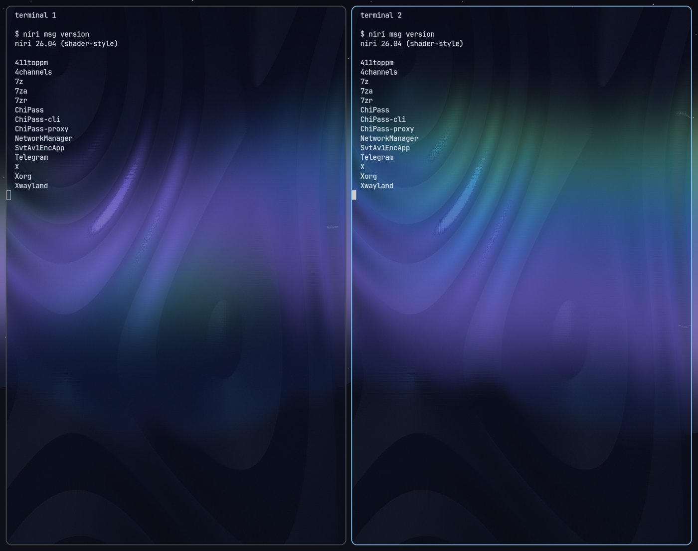
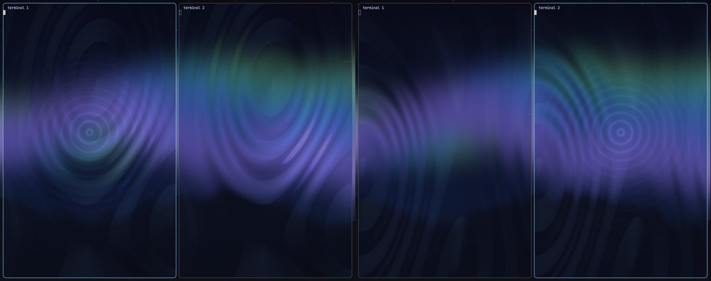

# niri shader-style

A fork of [niri](https://github.com/niri-wm/niri) 26.04 where the look of a window is a fragment shader that you write.
A window rule points at a `.frag` file, and the shader draws the background, border, glow, shadow or glass of that window.
There is no rebuild when you change a look: save the file, and the window changes within a moment.

Everything else about niri is the same: the scrolling tiling layout, input, animations and the config format.
Configs without a `style` block work as before.



## An example

```kdl
window-rule {
    match app-id="kitty"
    clip-to-geometry true
    background-effect { blur true; xray false; }

    style {
        palette { primary "#89b4fa"; secondary "#cba6f7"; accent "#f38ba8"; }
        shader "~/.config/niri/shaders/neon.frag"
        corner-radius 14
        margin 40
        param "width" 2.5
        param "speed" 2.0
    }
}
```

And the shader. It returns a premultiplied color for the pixel at `px`, which is in logical pixels from the top-left corner of the window:

```glsl
uniform float width;
uniform float speed;

vec4 style_color(vec2 px, vec2 size) {
    float d = u_window_sdf(px);                       // distance to the window edge, < 0 inside
    float line = 1.0 - smoothstep(width * 0.5 - 0.5, width * 0.5 + 0.5, abs(d - width * 0.5));
    float pulse = 0.5 + 0.5 * sin(u_time * speed);
    vec3 color = mix(u_palette(U_PRIMARY).rgb, u_palette(U_ACCENT).rgb, px.x / size.x);
    return u_premul(vec4(color, line * mix(0.55, 0.75 + 0.25 * pulse, u_focused)));
}
```

Three example shaders are in `docs/wiki/examples/shaders/`: `glass.frag`, `neon.frag` and `gradient_border.frag`.

## What a shader can use

| Uniform | Meaning |
|---|---|
| `u_time` | Seconds, wraps every hour. A shader that mentions it is redrawn continuously while it is on screen. |
| `u_size`, `u_pos`, `u_radius` | Window size, position in the workspace view, corner radii. |
| `u_focused` | 1.0 for the active window. |
| `u_palette(i)` | Four colors from the `palette` block: primary, secondary, accent, background. |
| `u_backdrop_at(px)` | The pixels behind the window. For glass, refraction and blur-based looks. |
| `u_pointer`, `u_pointer_amount` | Where the pointer is over the window, and how much it is there, eased. |
| `u_window_sdf(px)` | Signed distance to the rounded window edge. |
| anything declared `uniform float name;` | Set from `param "name" value` in the config. |

The full reference is in `docs/wiki/Configuration:-Window-Rules.md`, under `style`.



## How it is built

The change is about 2,000 lines in 25 files, on top of niri 26.04.

- **Config.** `niri-config/src/style.rs` parses the `style` block: palette, shader path, corner radius, margin and params. Rules merge field by field, like the other window rule properties. The shader file is read while parsing, and its path is added to the files niri already watches, so editing it reloads it. A missing file is a warning in the log, not a config error. A bad color or parameter name is a normal config error.
- **Resolve.** The merged style becomes part of `ResolvedWindowRules`. `corner-radius` in a style is the same as `geometry-corner-radius`.
- **Render.** `src/render_helpers/style.rs` has a `StyleRenderElement` that draws a quad around and behind the window, on top of niri's existing shader element. The program is compiled lazily on first render and cached by shader path. When the file changes and the new version does not compile, the previous working program stays in use and the compiler output goes to the log. When there is none, the window gets the default decorations.
- **Backdrop.** A shader that uses `u_backdrop_at()` makes the element a framebuffer effect. niri already has this for its non-xray blur: the frame behind the window is copied to a texture before the element is drawn. The style reuses that.
- **Tiles.** In `src/layout/tile.rs` the style replaces the border, focus ring and shadow of the window. A tile that is dragged or fading is drawn to an offscreen buffer, where the backdrop is not available, so the style and the blur are drawn separately behind that buffer.
- **Redraws.** niri normally redraws only when something changes. An animated style asks for redraws only while the tile is on a visible workspace and inside its view. A static shader costs nothing when idle.

204 tests run in the main crate (one of them covers dragging a floating window with an animated style) and 32 in `niri-config`.

## Limits

- The backdrop is not available while a window opens or closes, so a shader that needs it is not drawn then. This is the same limit that niri's own non-xray blur has.
- Shaders are GLSL ES 1.00. A style replaces the border, focus ring and shadow of its window.
- Style shaders have no compatibility guarantee, like the custom animation shaders in niri.
- The backdrop is captured every frame the window is redrawn, so a big animated glass window costs GPU time. Static ones do not.
- Tested in a nested session and on one real session with one monitor. Rotated outputs and several monitors have not been tested.

## Build

```bash
cargo build --release --no-default-features --features dbus,systemd
```

The default features include screencasting through PipeWire, which needs `libclang` to build. The command above leaves it out. To keep screencasting, install `clang` and use the default features.

To try it without leaving your session, run the binary inside it and it opens as a window:

```bash
NIRI_CONFIG=/path/to/config.kdl ./target/release/niri
```

## For a presentation

One sentence: the look of a window in a tiling compositor is a shader file that you edit live.

A possible set of slides:

1. The problem: window borders in tiling compositors are a rectangle with a color. Upstream niri allows custom shaders only for the open, close and resize animations.
2. The idea: a `style` block in a window rule, and one shader per rule.
3. Demo: a neon border on a terminal, then edit the shader and watch it change.
4. What a shader gets: palette, params, time, backdrop, pointer. One slide with the table above.
5. Glass: blur plus refraction of what is behind the window, with the video of a ShojiWM terminal as the reference.
6. How it works: parse, resolve, render, cache, with the fallback when a shader fails.
7. The hard parts: keeping it running while a window is dragged, redraws only when needed, the backdrop in offscreen buffers.
8. Limits and next steps.

A live demo that takes two minutes:

1. Show a plain terminal.
2. Add the `style` rule from the example above. The window changes without a restart.
3. Open the shader, change `width` or the colors, save. The window changes again.
4. Break the shader on purpose. The window keeps the last working look, and the log says why.
5. Open a second terminal with the glass shader over a busy wallpaper and drag it.

Questions to expect: how is this different from blur (blur is one effect, this is a program per window); what happens if the shader is wrong (the previous one stays); what it costs when idle (nothing for static shaders); why a fork and not a plugin (niri has no plugin API, so the renderer and the config had to change).

## Credits and license

niri is by Ivan Molodetskikh and contributors, GPL-3.0-or-later, and so is this fork.
The idea comes from [ShojiWM](https://github.com/bea4dev/ShojiWM) by bea4dev, a compositor with a shader pipeline, and from its "Liquid Terminal" configuration.
Shaders from that configuration are not in this repository, because it has no license file.
