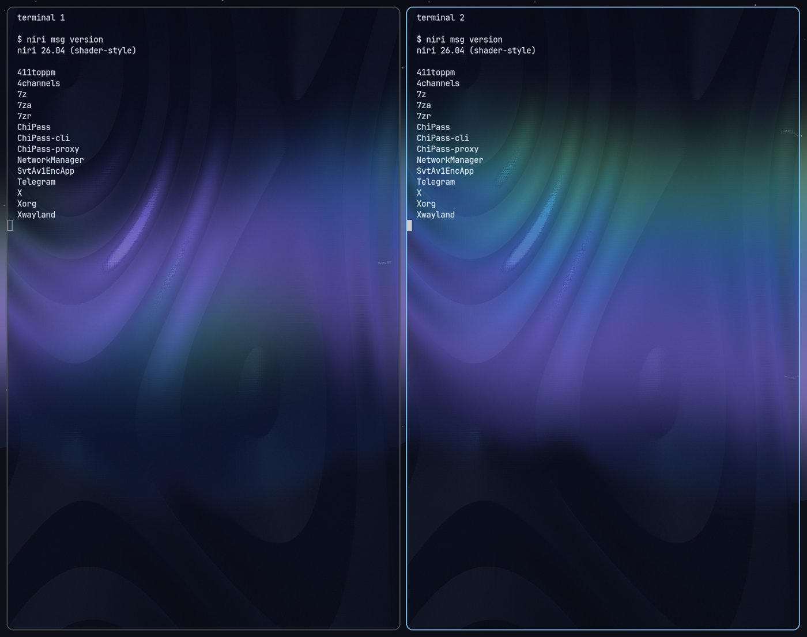
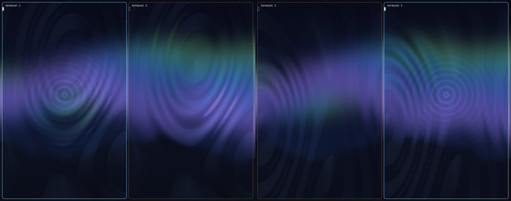

# niri shader-style (українською)

Форк [niri](https://github.com/niri-wm/niri) 26.04, де вигляд вікна задає фрагментний шейдер, який пишеш ти.
Правило вікна вказує на файл `.frag`, а шейдер малює фон, рамку, свічення, тінь або скло цього вікна.
Перезбирати нічого не треба: збережи файл, і вікно зміниться за мить.

Усе інше в niri таке саме: тайлінг з прокруткою, ввід, анімації та формат конфігу. Конфіги без блоку `style` працюють як раніше.



## Приклад

```kdl
window-rule {
    match app-id="kitty"
    clip-to-geometry true
    background-effect { blur true; xray false; }

    style {
        palette { primary "#89b4fa"; secondary "#cba6f7"; accent "#f38ba8"; }
        shader "~/.config/niri/shaders/neon.frag"
        corner-radius 14
        margin 40
        param "width" 2.5
        param "speed" 2.0
    }
}
```

Шейдер повертає колір (з попередньо помноженою прозорістю) для пікселя `px`, у логічних пікселях від лівого верхнього кута вікна. Вікно та його фон за склом шейдер бачить через `u_backdrop_at(px)`.

Готові приклади: `docs/wiki/examples/shaders/` (`glass.frag`, `neon.frag`, `gradient_border.frag`). Повний опис змінних (`u_time`, `u_size`, `u_pos`, `u_focused`, `u_palette`, `u_pointer`, власні `param`) у `docs/wiki/Configuration:-Window-Rules.md`, розділ `style`. Англійською те саме докладніше в [SHADER_STYLE.md](SHADER_STYLE.md).



## Що вміє

- Один шейдер на правило вікна, палітра з чотирьох кольорів і числові параметри (`param`), які потрапляють у шейдер як `uniform float`.
- Час (`u_time`) для анімації. Анімований шейдер перемальовується безперервно лише поки вікно видно на екрані. Статичний не коштує нічого.
- Доступ до того, що за вікном (`u_backdrop_at`): скло, заломлення, розмиття.
- Позиція курсора над вікном (`u_pointer`, `u_pointer_amount`): наприклад, кільця від курсора.
- Гаряче перезавантаження: шейдер стежиться разом із конфігом. Якщо нова версія не компілюється, лишається попередня робоча, а причина йде в лог.
- Помилки не валять композитор: битий колір або назва параметра це звичайна помилка конфігу (niri лишає старий конфіг), а відсутній файл шейдера лише попередження, і вікно малюється звичайно.
- Працює під час перетягування вікна мишею: у цей момент niri малює плитку в окремий буфер, і стиль із розмиттям малюються поза ним.

## Як влаштовано

Зміни займають близько 2000 рядків у 25 файлах поверх niri 26.04.

- **Конфіг.** `niri-config/src/style.rs` розбирає блок `style`. Файл шейдера читається під час розбору, його шлях додається до файлів, які niri уже відстежує.
- **Правила.** Підсумковий стиль входить у `ResolvedWindowRules`.
- **Рендер.** `src/render_helpers/style.rs`: елемент `StyleRenderElement` малює прямокутник навколо і за вікном. Програма компілюється при першому кадрі й кешується за шляхом шейдера.
- **Фон за вікном.** Використано механізм захоплення кадру, який у niri уже є для розмиття.
- **Плитка.** `src/layout/tile.rs`: стиль замінює рамку, кільце фокуса і тінь цього вікна.

204 тести в основному крейті (один перевіряє перетягування плаваючого вікна з анімованим стилем) і 32 у `niri-config`.

## Обмеження

- Поки вікно відкривається чи закривається, фон за ним недоступний, тому шейдер, якому він потрібен, тоді не малюється (те саме обмеження має вбудоване розмиття niri).
- Шейдери на GLSL ES 1.00. Гарантії сумісності між версіями немає.
- Великий анімований скляний термінал коштує часу відеокарти, бо фон копіюється кожен кадр.
- Перевірено у вкладеному режимі та в одній справжній сесії з одним монітором. Повернуті виходи та кілька моніторів не перевірялись.

## Збірка

```bash
cargo build --release --no-default-features --features dbus,systemd
```

У стандартних можливостях є демонстрація екрана через PipeWire, їй для збірки потрібен `libclang`. Команда вище її не включає. Щоб залишити, встанови `clang` і збирай зі стандартними можливостями.

## Для презентації

Одне речення: вигляд вікна в тайловому композиторі це файл шейдера, який редагуєш наживо.

Можливі слайди:

1. Проблема: рамки вікон у тайлових композиторах це прямокутник із кольором. В оригінальному niri власні шейдери є лише для анімацій відкриття, закриття та зміни розміру.
2. Ідея: блок `style` у правилі вікна й один шейдер на правило.
3. Демо: неонова рамка на терміналі, потім правка шейдера й зміна вікна.
4. Що отримує шейдер: палітра, параметри, час, фон, курсор.
5. Скло: розмиття плюс заломлення того, що за вікном. Референс: відео «Liquid Terminal» для ShojiWM.
6. Як працює: розбір конфігу, правила, рендер, кеш, запасний варіант при помилці шейдера.
7. Складні місця: робота під час перетягування вікна, перемальовування лише коли потрібно, фон у відокремлених буферах.
8. Обмеження й що далі.

Демо на дві хвилини:

1. Показати звичайний термінал.
2. Додати правило `style` із прикладу вище, вікно змінюється без перезапуску.
3. Відкрити шейдер, змінити `width` або кольори, зберегти: вікно змінилось знову.
4. Навмисно зламати шейдер: вікно лишає останній робочий вигляд, у логу причина.
5. Відкрити другий термінал зі скляним шейдером над строкатими шпалерами й потягти його.

Можливі запитання: чим це відрізняється від розмиття (розмиття це один ефект, а тут програма на кожне вікно); що буде, якщо шейдер неправильний (лишиться попередній); що коштує у спокої (для статичних шейдерів нічого); чому форк, а не плагін (у niri немає системи плагінів, тому довелося змінити рендер і конфіг).

## Подяки й ліцензія

niri створив Іван Молодецьких (Ivan Molodetskikh) та учасники проєкту, ліцензія GPL-3.0-or-later, така сама і в цього форка.
Ідея походить від [ShojiWM](https://github.com/bea4dev/ShojiWM) (автор bea4dev), композитора з конвеєром шейдерів, і його конфігурації «Liquid Terminal».
Шейдери з тієї конфігурації в цьому репозиторії не лежать, бо в неї немає ліцензії.
